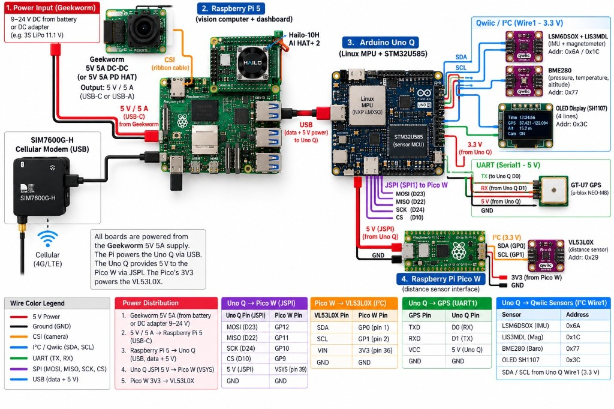
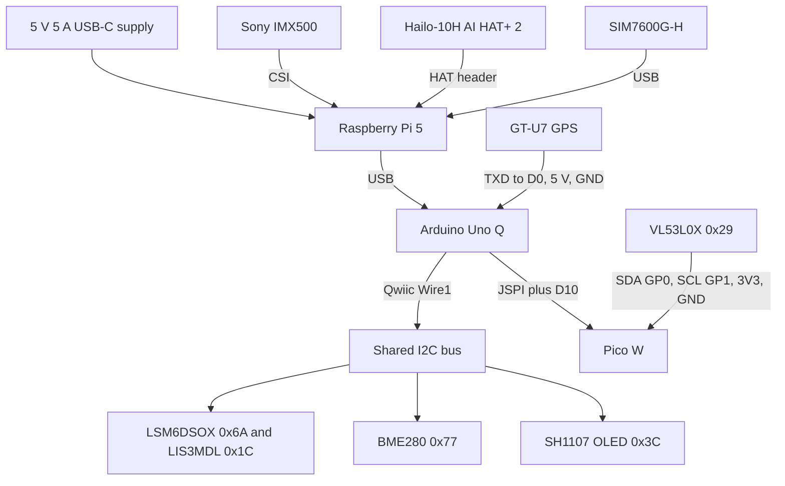

# Wiring

How the boards and sensors are connected. No accounts, numbers, or provider names.

The poster matches this build except for three labels. Use this page where they disagree.

- The GPS is a GT-U7, a u-blox 7. It is not a NEO-M8.
- GPS RXD stays disconnected. Only TXD goes to D0. Do not wire RXD to D1.
- Power is the Pi's own 5 V 5 A USB-C supply. There is no Geekworm converter in this stack.

The JSPI pin table on the poster is right. That header is bit-banged. It is not the hardware SPI on D11, D12, and D13. The Qwiic parts share one bus. They are chained, not four separate home-run cables.

The Pi does not wire to the sensors. It reaches the Uno Q over USB. The Pico does not wire to the Pi. It answers the Uno Q on the JSPI header.

## Raspberry Pi 5

| From | To | Connection |
|---|---|---|
| 5 V 5 A supply | Pi USB-C | Power |
| IMX500 | Pi CSI | Camera |
| Hailo-10H AI HAT+ 2 | Pi HAT header | Neural processor |
| Uno Q USB | Pi USB | Data. The Linux side of the Uno Q |
| SIM7600G-H | Pi USB | Cellular modem |

## Uno Q Qwiic bus

`Wire1` is the Qwiic connector. These share that bus. The IMU module and the BME280 are chained. The OLED is on the same connector.

| Device | Address | Bus |
|---|---|---|
| LSM6DSOX accelerometer and gyro | `0x6A` | Qwiic, `Wire1` |
| LIS3MDL magnetometer | `0x1C` | Qwiic, `Wire1` |
| BME280 barometer | `0x77` | Qwiic, `Wire1` |
| Adafruit FeatherWing 4650 OLED | `0x3C` | Qwiic, `Wire1` |

## GPS

The GT-U7 is not on Qwiic. Power comes through the micro-USB plug, not the VCC header pin.

| GT-U7 | Uno Q |
|---|---|
| TXD | D0, `Serial1` RX, 9600 baud |
| micro-USB red | 5 V |
| micro-USB black | GND |
| RXD | Not connected |
| PPS | Not connected |
| USB green and white | Not connected. Those are USB data, not UART |

D1 stays empty. It is the console transmit pin. Wiring it to the receiver corrupts the NMEA stream. The black wire has to land on Uno Q ground.

## Pico W on the JSPI header

| Uno Q | Pico W |
|---|---|
| JSPI MOSI, D23 | GP12 |
| JSPI MISO, D22 | GP11 |
| JSPI SCK, D24 | GP10 |
| D10 chip select | GP9 |
| JSPI 5 V | VSYS |
| JSPI GND | GND |

JSPI pin 5 is reset. Leave it unconnected.

## VL53L0X on the Pico

| VL53L0X | Pico W |
|---|---|
| SDA | GP0, physical pin 1 |
| SCL | GP1, physical pin 2 |
| VIN | 3V3, physical pin 36 |
| GND | GND |

There is no lidar on the Pico. The distance sensor is this VL53L0X only.
