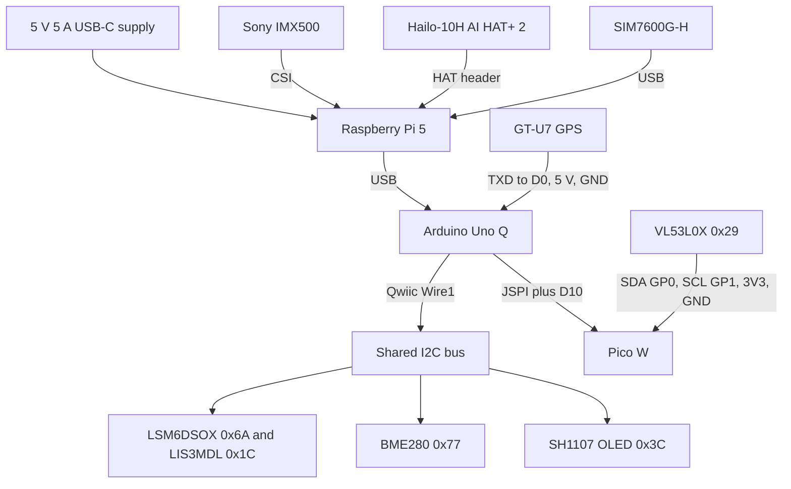

# Wiring

How the boards and sensors are connected. No accounts, numbers, or provider names.

The poster matches this build except for three labels. Use this page where they disagree.

- The GPS is a GT-U7, a u-blox 7. It is not a NEO-M8.
- GPS RXD stays disconnected. Only TXD goes to D0. Do not wire RXD to D1.
- Power is the Pi's own 5 V 5 A USB-C supply. There is no Geekworm converter in this stack.

The JSPI pin table on the poster is right. That header is bit-banged. It is not the hardware SPI on D11, D12, and D13. The Qwiic parts share one bus. They are chained, not four separate home-run cables.

The Pi does not wire to the sensors. It reaches the Uno Q over USB. The Pico does not wire to the Pi. It answers the Uno Q on the JSPI header.

## What runs where

The Hailo board is an NPU, a chip that runs one neural network. It is not the Pi's GPU. The Pi CPU captures the picture, draws the boxes, serves the web page, and today also runs the language models.

| Work | Chip | Model | How it is used |
|---|---|---|---|
| Person and object detection | Hailo-10H on the AI HAT+ 2 | YOLOv11m, file `yolov11m_h10.hef` | `watcher.py` resizes each camera frame to 640×640 and sends it to `/dev/hailo0`. The HAT returns the boxes. The CPU draws them. |
| Vision-language model, installed now | Pi 5 CPU, through Ollama | `moondream:1.8b` | Answers a question about a camera frame. Ollama listens on port 11434. This is not part of the live detector. |
| Text language model, installed now | Pi 5 CPU, through Ollama | `qwen2.5:1.5b` | Answers text questions. Same Ollama service. This is not part of the live detector. |
| Dashboard, mail, telemetry bridge | Pi 5 CPU | none | `watcher.py` and `unoq_bridge.py` |
| IMU, barometer, GPS, OLED, Pico poll | Uno Q STM32 | none | `motorController` sketch |
| Distance | Pico W | none | VL53L0X driver |

The live dashboard uses only the Hailo detector. A person is reported when YOLOv11m sees a person and the Pico distance stays at or inside 30 cm for 2 seconds. Moondream and Qwen are installed for asking the camera or a text model a question. They do not decide the alert.

### Why the language models are on the CPU

The NPU cannot run an Ollama model. Ollama's `moondream:1.8b` and `qwen2.5:1.5b` are ordinary CPU models. The Hailo-10H only runs a model that Hailo has compiled into its own `.hef` file.

YOLOv11m is on the HAT because that `.hef` came inside the Hailo apt package. The matching language-model files were never installed. The Hailo download site blocked the headless download, so Ollama was installed as the working fallback. Moondream itself has no Hailo build.

### Models this HAT can run

The on-chip firmware is version **5.1.1**. A model compiled for a newer Hailo release will not load until the HAT firmware and the Hailo software are updated together. The pair to use on this board is:

| Job | Model | Hailo name |
|---|---|---|
| Text model | Qwen2.5-1.5B-Instruct | `qwen2.5-instruct:1.5b` |
| Vision model | Qwen2-VL-2B-Instruct | `Qwen2-VL-2B-Instruct.hef` |

Use the **5.1.1** compile of Qwen2-VL. Hailo later rebuilt that same model for 5.2 and newer, and that newer file is about 1 GB larger. It does not load on 5.1.1 firmware.

These other text models are also in the 5.1.1 set, and they also run on this HAT. They are not the pair to use with the vision model:

| Model | What it is |
|---|---|
| `qwen2:1.5b` | General text model |
| `qwen2.5-coder:1.5b` | Code model |
| `deepseek_r1_distill_qwen:1.5b` | Reasoning model |
| `llama3.2:3b` | General text model |

Those Hailo language models are served by Hailo's own program, `hailo-ollama`, on port 8000. That is a different program from the Ollama install on port 11434.

Speech models compiled for this chip (Whisper Tiny, Base, and Small) and a later video model (Qwen3-VL-2B) need Hailo software 5.2.0 or newer. They are not for this firmware.

## Raspberry Pi 5

| From | To | Connection |
|---|---|---|
| 5 V 5 A supply | Pi USB-C | Power |
| IMX500 | Pi CSI | Camera |
| Hailo-10H AI HAT+ 2 | Pi HAT header | Neural processor |
| Uno Q USB | Pi USB | Data. The Linux side of the Uno Q |
| SIM7600G-H | Pi USB | Cellular modem |

## Uno Q Qwiic bus

`Wire1` is the Qwiic connector. These share that bus. The IMU module and the BME280 are chained. The OLED is on the same connector.

| Device | Address | Bus |
|---|---|---|
| LSM6DSOX accelerometer and gyro | `0x6A` | Qwiic, `Wire1` |
| LIS3MDL magnetometer | `0x1C` | Qwiic, `Wire1` |
| BME280 barometer | `0x77` | Qwiic, `Wire1` |
| Adafruit FeatherWing 4650 OLED | `0x3C` | Qwiic, `Wire1` |

## GPS

The GT-U7 is not on Qwiic. Power comes through the micro-USB plug, not the VCC header pin.

| GT-U7 | Uno Q |
|---|---|
| TXD | D0, `Serial1` RX, 9600 baud |
| micro-USB red | 5 V |
| micro-USB black | GND |
| RXD | Not connected |
| PPS | Not connected |
| USB green and white | Not connected. Those are USB data, not UART |

D1 stays empty. It is the console transmit pin. Wiring it to the receiver corrupts the NMEA stream. The black wire has to land on Uno Q ground.

## Pico W on the JSPI header

| Uno Q | Pico W |
|---|---|
| JSPI MOSI, D23 | GP12 |
| JSPI MISO, D22 | GP11 |
| JSPI SCK, D24 | GP10 |
| D10 chip select | GP9 |
| JSPI 5 V | VSYS |
| JSPI GND | GND |

JSPI pin 5 is reset. Leave it unconnected.

## VL53L0X on the Pico

| VL53L0X | Pico W |
|---|---|
| SDA | GP0, physical pin 1 |
| SCL | GP1, physical pin 2 |
| VIN | 3V3, physical pin 36 |
| GND | GND |

There is no lidar on the Pico. The distance sensor is this VL53L0X only.
